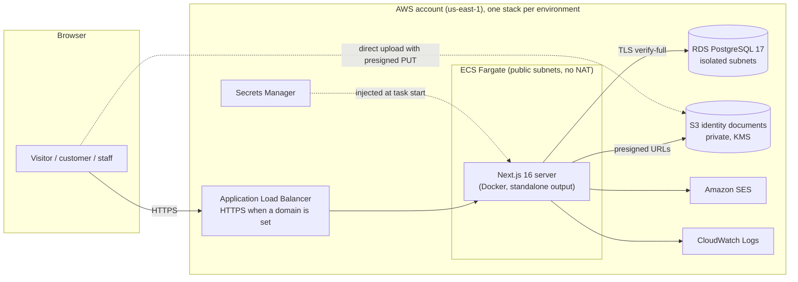

# Architecture

## Goals and constraints

- **Sell legally.** Kratom, kava and hemp-derived THC are regulated differently by state and over
  time. Every sale is checked against dated, sourced rules on the server, and the check fails closed
  ([compliance.md](compliance.md)).
- **Know every buyer is 21+.** Sign-up requires a government ID; staff approve it before the first
  order ([features/accounts-and-age-verification.md](features/accounts-and-age-verification.md)).
- **Serve retail and wholesale from one catalogue.** Wholesale accounts see their own prices,
  terms and pack sizes ([features/checkout.md](features/checkout.md)).
- **Stay cheap and simple to run** for a small business, and easy to extend with Claude Code:
  one deployable app, typed end to end, with conventions written down.

## System overview



## Stack and why

| Layer      | Choice                                                     | Why (ADR)                                                                                                                            |
| ---------- | ---------------------------------------------------------- | ------------------------------------------------------------------------------------------------------------------------------------ |
| App        | Next.js 16 App Router, one monolith with feature modules   | One codebase for pages, forms and API; Server Actions remove most API plumbing ([0001](decisions/0001-nextjs-monolith.md))           |
| Rendering  | Cache Components + Partial Prefetching (framework default) | Static shells load instantly; data streams in; no database needed at build time ([0008](decisions/0008-cache-components.md))         |
| Data       | PostgreSQL 17, Drizzle ORM, SQL migrations                 | Relational data (orders, prices, audits), typed queries, reviewable SQL ([0003](decisions/0003-postgres-drizzle-boot-migrations.md)) |
| Hosting    | AWS ECS Fargate + ALB, RDS, S3/KMS, SES, CDK               | Your choice of AWS; containers run any Next version; private database ([0002](decisions/0002-aws-ecs-fargate-cdk.md))                |
| Catalog    | Defined in code, synced to the database                    | Reviewed through PRs until an admin UI exists ([0004](decisions/0004-catalog-as-code.md))                                            |
| Compliance | Rules as code, tested, fail closed                         | Auditable and dated; can't be bypassed by the UI ([0005](decisions/0005-compliance-rules-as-code.md))                                |
| Payments   | Gateway adapter, high-risk merchant account                | Stripe prohibits kava sellers ([0006](decisions/0006-payments-gateway-adapter.md))                                                   |
| Accounts   | Better Auth (planned), manual ID review first              | Self-hosted sessions in our Postgres; vendor ID checks can plug in later ([0007](decisions/0007-auth-and-id-verification.md))        |

## Code organization

```
src/app/            Routes. Thin: compose feature components, read params, set metadata.
src/features/x/     Everything for one feature: UI, Server Actions, services, queries, zod schemas, tests.
src/server/         Infrastructure adapters: database client and schema, email drivers, env, request info.
src/domain/         Pure shared constants (ingredient classes, US states, business details).
src/lib/            Pure helpers (pagination, form state, zod building blocks).
src/components/     Shared UI (layout, form fields, buttons, badges).
```

Dependencies point inward: `app → features → server | domain | lib | components`. Infrastructure
never imports features; the only composition roots are `src/instrumentation-node.ts` (boot tasks)
and `scripts/`. A new feature is a new folder in `src/features/` plus its routes.

## Request flows

**Catalogue page** (`/catalog/shots?page=2`)

1. The prerendered static shell (header, title, skeleton) is served immediately.
2. Inside `<Suspense>`, `CategoryResults` awaits `params` and `searchParams`, validates the category
   and calls `getCatalogPage('shots', 2)`.
3. `getCatalogPage` is a `'use cache'` function (`cacheLife('hours')`, tag `catalog`): one grouped
   count query and one page query, cached per argument pair.
4. On a product page, `ProductAvailability` calls `connection()` and evaluates the compliance rules
   for today's date, so availability is always current while the rest of the page is cached.

**Form submission** (wholesale application, contact)

1. A client form posts to a Server Action through `useActionState` (works without JavaScript too).
2. The action converts FormData to values, drops honeypot submissions, validates with the shared
   zod schema, and returns field errors plus the submitted values on failure.
3. The service checks a per-IP-hash rate limit, writes the row and an `audit_events` row in one
   transaction, then emails sales (SES in production, console locally). An email failure is
   logged and never loses the submission.

## Environments

| Environment | Where                      | Database                      | Email   | Deploys                           |
| ----------- | -------------------------- | ----------------------------- | ------- | --------------------------------- |
| Local       | `npm run dev`              | Docker Postgres 17            | console | n/a                               |
| CI          | GitHub Actions             | Postgres 17 service container | console | n/a                               |
| Staging     | `EastsideStaging` stack    | RDS t4g.micro, disposable     | SES     | automatic after CI passes on main |
| Production  | `EastsideProduction` stack | RDS t4g.small, protected      | SES     | manual + required approval        |

Containers run pending migrations and sync the catalog at boot, serialized with a Postgres advisory
lock. A failed boot exits, and the ECS circuit breaker rolls the deployment back. Migrations must
therefore be backward compatible (`.claude/skills/db-change`). Pipeline details:
[runbooks/deployments.md](runbooks/deployments.md).

## Security and privacy

- **Network:** only the load balancer is public. Tasks accept traffic only from the load balancer.
  The database sits in isolated subnets and accepts only the tasks' security group.
- **Secrets:** generated in Secrets Manager and injected as ECS secrets. Deploys use GitHub OIDC
  (no stored AWS keys). The deploy role can only assume CDK's bootstrap roles.
- **Identity documents:** private bucket, customer-managed KMS key, TLS-only, no versioning (deletes
  are final), a lifecycle backstop (30 days staging, 90 production), server access logs. Browsers
  upload with presigned PUTs; staff view with short-lived presigned GETs.
- **Personal data:** IP addresses are stored only as keyed hashes. No PII goes in logs, cache keys
  or audit metadata. Staff-only fields never render on public pages.
- **App hardening:** security headers (HSTS, nosniff, frame denial, referrer and permissions
  policies), zod validation on every input, rate limits and honeypots on public forms, cdk-nag
  (AWS Solutions) gating every infra change.
- **To add before launch:** Content-Security-Policy with nonces, AWS WAF with managed rules,
  CloudWatch alarms. See the roadmap.

## Cost (rough estimate)

At low traffic in us-east-1, expect roughly **$60–80/month for staging** and **$100–130/month for
production**. That covers the load balancer (~$22), Fargate tasks (~$18 each), public IPv4
(~$4 each), RDS (~$14 micro / ~$26 small), and KMS, Secrets Manager and logs (~$5). Levers: scale
staging to zero tasks when idle, or run staging only when needed. These are estimates; check the
AWS Pricing Calculator.

## Extending the system

Use the `/feature` skill. It walks a roadmap item through spec, schema, server, UI, tests and docs
in this repo's conventions. Keep new infrastructure behind small adapters (as with email, and
planned for payments, ID verification and tax), so providers can change without touching features.
