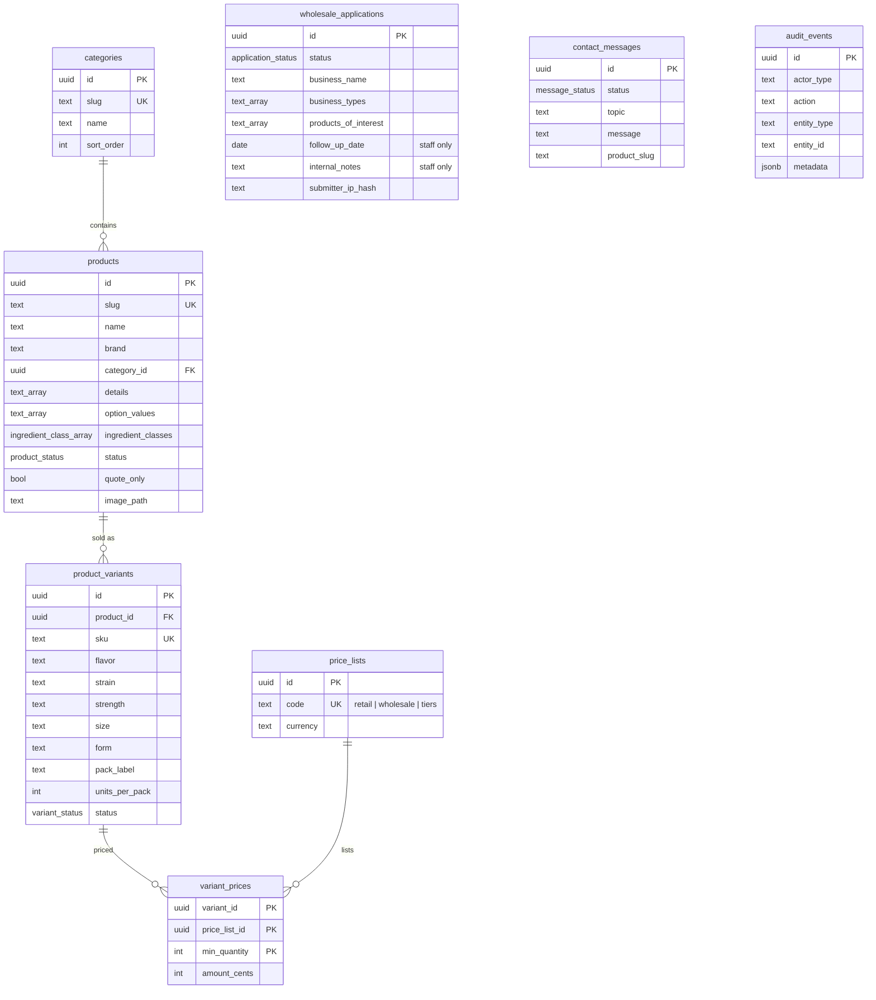

# Data model

Source of truth: `src/server/db/schema/*.ts` (Drizzle; camelCase in TypeScript, snake_case in
SQL). Migrations: `drizzle/`. Change it with `.claude/skills/db-change`.

## Implemented (Phase 0)

| Table                    | Notes                                                                                                                                                                                       |
| ------------------------ | ------------------------------------------------------------------------------------------------------------------------------------------------------------------------------------------- |
| `categories`             | The 7 catalogue sections. Upserted from code (`src/features/catalog/categories.ts`).                                                                                                        |
| `products`               | 32 products from the 2026 catalogue. `ingredient_classes` drives compliance. Status `active`, `coming_soon`, `draft` or `archived`; products removed from code are archived, never deleted. |
| `product_variants`       | One SKU per flavor/strain × size/strength/form × pack (240 today). SKUs derive from the product code and option codes, so never change those once orders exist.                             |
| `price_lists`            | `retail` and `wholesale` seeded. Per-account tiers come later.                                                                                                                              |
| `variant_prices`         | Empty until the business supplies prices. Integer cents; `min_quantity` supports volume breaks.                                                                                             |
| `wholesale_applications` | The paper onboarding sheet, sections 1–9 from the form, section 10 (follow-up date, assignee, notes) for staff. Answer choices are stored as option codes in text arrays.                   |
| `contact_messages`       | Contact form submissions with an optional product reference.                                                                                                                                |
| `audit_events`           | Append-only log of business actions. IDs only, never PII.                                                                                                                                   |

## Planned

**Phase 1: accounts and age verification**

- `user`, `session`, `account`, `verification`: generated by Better Auth's CLI for the Drizzle
  adapter. `user` gains `role` (`customer` | `staff` | `admin`) and `date_of_birth`.
- `id_verifications`: `user_id`, `status` (`pending` | `approved` | `rejected` | `expired`),
  `document_type`, object keys for front/back images, `date_of_birth` as reviewed,
  `reviewed_by`, `reviewed_at`, `rejection_reason`, `images_deleted_at`.

**Phase 2: wholesale accounts**

- `wholesale_accounts`: business, resale certificate number and expiry, `tax_exempt`,
  `payment_terms` (`prepaid` | `net15` | `net30`), `price_list_id`, status, approval fields,
  plus an `application_id` back to the application.
- `wholesale_account_members`: `account_id`, `user_id`, role (`owner` | `buyer`).

**Phase 3: commerce**

- `carts`, `cart_items`.
- `addresses`: shipping addresses with a validated state.
- `orders`: number, user, wholesale account, channel, status, fulfillment method
  (`ship` | `pickup` | `local_delivery`), money totals in cents, tax-exempt snapshot, compliance
  snapshot (rules evaluated and the date).
- `order_items`: price and product snapshots.
- `payments`: provider, reference, amount, status. Never card data.
- `invoices`: Net 15 / Net 30 terms.
