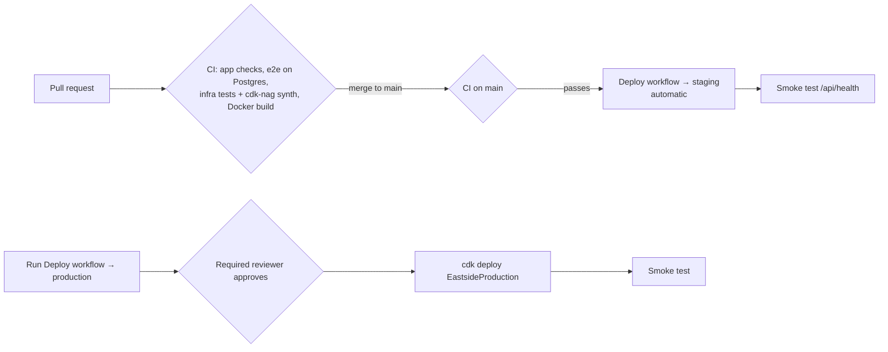

# Deployments

## Pipeline

- **CI** (`.github/workflows/ci.yml`): lint, typecheck, format check, unit tests, production build;
  Playwright against Postgres 17 with migrations and seed; infra typecheck, assertion tests,
  `cdk synth --strict` with cdk-nag; Docker image build.
- **Deploy** (`.github/workflows/deploy.yml`): GitHub OIDC → `eastside-github-deploy` role →
  `cdk diff` → `cdk deploy` (builds the image, pushes it to the CDK asset repository, rolls ECS)
  → `/api/health` smoke test. Deploys only CI runs triggered by pushes in this repository.

## What happens during a deploy

1. New tasks start with the new image (old tasks keep serving; minimum healthy 100%).
2. Each new task takes a Postgres advisory lock, applies pending migrations, syncs the catalog,
   then starts serving.
3. The load balancer health-checks `/api/health`. Healthy tasks receive traffic, and old tasks
   drain (30 s).
4. If new tasks fail (boot error, failed migration, health check), the ECS circuit breaker rolls
   back to the previous task definition. The database schema stays migrated, which is why
   migrations must be backward compatible.

## Production release

Actions → **Deploy** → Run workflow → `production` → approve. It deploys the selected ref, usually
`main`, which staging has already run.

## Rollback

- **App bug:** revert the commit on `main` (staging redeploys automatically), then run the
  production deploy. Or redeploy an earlier ref by running the workflow on that commit.
- **Bad migration:** write a new forward migration that fixes it. Never edit or delete an applied
  migration.
- **Data loss emergency:** restore RDS to a point in time (backups: 3 days staging, 14 days
  production) into a new instance and switch over. Test this before launch (roadmap, Phase 4).

## Logs

CloudWatch log groups per environment: web container (`…WebLogs…`), Postgres
(`/aws/rds/instance/eastside-<env>/postgresql`), VPC rejected flows. Load balancer and bucket
access logs are in the stack's access-log bucket.
